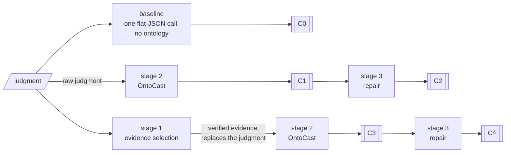

# Ablation study: what an evidence stage and a repair stage contribute to ontology-guided extraction

This directory implements a five-condition ablation over a pipeline that
extracts the **domestic procedural history** of a case — the chain of national
proceedings, the authorities that decided them, the parties to each, and their
outcomes — from European Court of Human Rights judgments, as an RDF graph
against a fixed domain ontology.

The study asks a question that generalises beyond this corpus: **when an LLM
writes a knowledge graph against an ontology, how much of the result's quality
comes from the ontology, how much from constraining the model to verbatim
evidence, and how much from a validation-driven repair pass?** Each is added and
removed independently and scored at both extraction and post-repair
checkpoints.

This README is the methods description and the reproduction procedure. The
experiment plan it implements is `docs/JURIX_2.md`; the ontology and its SHACL
shapes are in `ontology/`.

---

## 1 · Method

### 1.1 The three components under test

| component | what it does | implementation |
|---|---|---|
| **Ontology guidance** (stage 2) | extraction is rendered as RDF against a fixed domain ontology, with closed vocabularies, typed nodes and SHACL shapes | [OntoCast](https://growgraph.github.io/ontocast/), an external LLM-to-knowledge-graph framework, in `render_mode=facts`; invoked by `run_native.py` |
| **Evidence stage** (stage 1) | an extractive pass returns *verbatim spans* of the source, then linking, person and critic agents — with a parallel-track agent, a targeted parties pass and a fixer triggered by the critic's flags — turn them into a checked procedural history with typed chain links; offsets are computed programmatically, and any span that cannot be located in the source is discarded. The graph stage then sees the verified evidence instead of the judgment | `agentic_stage1.py` + `render_bundles.py` |
| **Repair stage** (stage 3) | the graph is diffed against stage 1 and transcription gaps are fixed in code; the model is called to mint events the graph lacks, to repair SHACL violations, and as a final critic and graph fixer that may not change what stage 1 decided | `reconcile.py` |

### 1.2 Conditions

One model throughout (`gemma-4-31b`, served locally by vLLM), one document set,
five conditions.

| # | condition | evidence stage | ontology-guided graph | repair stage |
|---|---|:-:|:-:|:-:|
| **C0** | schema-light JSON baseline, one call, no ontology | — | — | — |
| **C1** | OntoCast alone — ontology-guided extraction from the raw judgment | — | ✓ | — |
| **C2** | C1 + repair | — | ✓ | ✓ |
| **C3** | evidence stage → ontology-guided extraction | ✓ | ✓ | — |
| **C4** | full pipeline | ✓ | ✓ | ✓ |

C1–C4 form a 2 × 2 factorial (evidence × repair), so each main effect is
estimated twice and the interaction is available. C0 sits outside the factorial
as a **matched** no-ontology baseline: the same task, the same target fields,
the same single call over the whole document, requested as flat JSON with no
schema, no closed vocabularies and no validation. Its prompt is published
verbatim (`art6/conditions/prompts/o1_schema_light.txt`) so that readers can
judge whether the baseline is a fair one.

### 1.3 Contrasts

| contrast | isolates | interpretation |
|---|---|---|
| **C1 vs C4** | the pipeline as a whole | does the added machinery beat OntoCast on its own |
| C1 vs C3, C2 vs C4 | the evidence stage | what constraining extraction to verified spans buys, with and without repair |
| C1 vs C2, C3 vs C4 | the repair stage | what validation-driven repair buys, with and without the evidence stage |
| C0 vs C1 | ontology guidance | whether formalisation earns its cost, at matched input and matched call budget |

C1 is the load-bearing control: it is OntoCast with nothing added, and without
it no claim about "the pipeline" is separable from a claim about the
ontology-guided extractor it is built around.

### 1.4 Design choices a replicator should carry over

**One extraction per input form, two checkpoints.** C1/C2 and C3/C4 are not four
extractions. They are the pre-repair and post-repair checkpoints of the *same*
two extraction runs:

```
C1_C2/raw = C1        C1_C2/repaired = C2
C3_C4/raw = C3        C3_C4/repaired = C4
```

Repair is therefore measured from byte-identical input on each side. Estimating
it against a separately re-extracted baseline would confound the repair effect
with extraction run-to-run variance, which is substantial even at temperature 0
(§5).

**Both checkpoints are scored for every condition that has them.** Recall is
largely a property of extraction and precision largely a property of repair; a
single score taken after both cannot separate them.

**Chunking is disabled.** Every document is processed as one unit in stage 2, so
the conditions differ only in the *text* they are given, not in how it was
segmented. Documents exceeding the context window are handled by splitting in
stage 1 (§2.1), not by chunking downstream.

### 1.5 Measures

Three tiers, reported separately and never averaged:

- **Evidence integrity** — the share of asserted supporting quotes that appear
  verbatim in the source document, and the share of asserted dates actually
  stated in it. C3/C4 are near-perfect here *by construction* rather than by
  degree: an unlocatable span is discarded in stage 1 and never reaches the
  graph. C0/C1/C2 carry no such guarantee. This is the study's structural
  result, and it is the one that does not depend on a scoring rubric.
- **Structural validity** — SHACL conformance, adherence to the ontology's
  closed vocabularies, invented vocabulary terms, functional-property
  violations, disjoint-type conflicts, participation cardinality, and
  deciding-body-as-party errors.
- **Content** — proceedings recovered, `followsProceeding` chain edges (the
  primary outcome measure), party coverage, attribute coverage, and graph
  connectivity.

Two cautions that apply to anyone reusing these measures:

- **A falling violation count is not by itself evidence of a better graph.** The
  cheapest way to satisfy a shape is to delete whatever violates it. Every
  conformance figure should be read beside content and connectivity figures that
  deletion would move in the wrong direction. `diagnostics/compare_v2.py`
  prints conformance and content axes side by side.
- **Richness is not triple volume.** Comparing an ontology-guided graph with a
  flat baseline on triple counts makes the graph win by construction, and
  scoring the graph on a flattened projection of itself makes it lose the same
  way. Both systems are therefore mapped into one triple vocabulary with
  nothing discarded on either side, predicates only the ontology can express
  are split into **evidenced** and **unevidenced** buckets, and vocabulary
  consistency is reported separately (`art6/conditions/project_triples.py`).
  "Evidenced and correct" requires a hand-built reference and is deliberately
  not computed mechanically.

Report the measures on which the baseline wins. A flat baseline can beat an
ontology-guided graph on raw coverage of a field — party coverage in
particular — while a share of what it recovers is wrong in a way the coverage
figure cannot show, such as listing the body that decided a proceeding as a
party to it. Reporting both the coverage figure and the error behind it is the
appropriate answer to the objection that the baseline is a strawman, and it is
why the party measures below are paired with a deciding-body-as-party check.

---

## 2 · The pipeline

**Which path each condition takes.** Every condition is one route through the
same three stages; nothing merges.



C1 and C3 are the two stage-2 runs — same configuration, different input text.
C2 and C4 are those same two graphs after repair, which is why the repair
contrast is measured from identical input on each side.

**The agents and their order.** Hexagons are model calls; rectangles are
deterministic steps; diamonds are routing decisions. A conditional agent runs
only when an earlier agent's mandatory flags, or a deterministic check, call
for it.

```mermaid
flowchart TD
    J[/"judgment"/]

    subgraph S1["Stage 1 — evidence → stage-1 payload (agentic_stage1.py)"]
        ED{{"Event detection<br/>events + parties + persons<br/>flag: domestic_events_found"}}
        Q0{"events found?"}
        LA{{"Linking<br/>tracks + predecessors"}}
        PI{{"Person identifier<br/>applicants + chain-aware parties<br/>(additive)"}}
        F1["filters + hints (code)"]
        CR{{"Stage-1 critic<br/>findings<br/>flags: needs_fix · parallel_tracks ·<br/>parties_incomplete"}}
        QP{"parallel_tracks<br/>= yes?"}
        TA{{"Parallel track agent<br/>re-partition + track relations"}}
        RL{{"Linking, re-run<br/>within the new tracks"}}
        QY{"parties_incomplete<br/>= yes?"}
        PT{{"Targeted parties pass<br/>on the named events"}}
        QF{"needs_fix<br/>= yes?"}
        FX{{"Stage-1 fixer<br/>ops on payload"}}
        T["re-filter + type links (code)"]
    end

    subgraph S2["Stage 2"]
        OC{{"OntoCast"}}
    end

    subgraph S3["Stage 3 — repair → graph (reconcile.py)"]
        RC["reconcile: transcribe (code)"]
        QM{"events<br/>missing?"}
        MI{{"Event recovery<br/>gated"}}
        QS{"violations?"}
        SV{{"SHACL violation agent<br/>≤3 rounds"}}
        RT["restore stage-1 decisions (code)"]
        FC{{"Final critic<br/>flags: needs_fix · stage1_dispute"}}
        QG{"needs_fix<br/>= yes?"}
        GF{{"Graph fixer<br/>gated per group,<br/>stage-1 triples locked"}}
        END["final counts (code)"]
    end

    EMPTY[/"empty bundle"/]

    J --> ED --> Q0
    Q0 -- no --> EMPTY
    Q0 -- yes --> LA --> PI --> F1 --> CR --> QP
    QP -- yes --> TA --> RL --> QY
    QP -- no --> QY
    QY -- yes --> PT --> QF
    QY -- no --> QF
    QF -- yes --> FX --> T
    QF -- no --> T
    T -->|"bundle"| OC --> RC --> QM
    QM -- yes --> MI --> QS
    QM -- no --> QS
    QS -- yes --> SV --> RT --> FC
    QS -- no --> FC
    FC --> QG
    QG -- yes --> GF --> END
    QG -- no --> END
```



| agent | runs | reads | writes | prompt |
|---|---|---|---|---|
| **Event detection** | always | judgment | events (verbatim spans, classifications, parties), persons, authorities; flag `domestic_events_found` | `extract.txt` |
| **Linking** | if any events | judgment + events + computed candidates | tracks; each event's predecessor and `continues` / `during` | `plan.txt` |
| **Person identifier** | if any events | judgment opening; judgment + events with their chain | applicants; parties added per event, shown the predecessor's parties | `applicants.txt`, `parties.txt` |
| **Stage-1 critic** | `--critic-rounds` ≥ 1 | judgment + full draft + hints | evidenced findings; flags `needs_fix`, `parallel_tracks`, `parties_incomplete` | `critic.txt` |
| **Parallel track agent** | `parallel_tracks = yes` | judgment + draft + the critic's evidence | tracks (`kind`, `subject`) and track relations (`during`, `arises_from`), then the linker re-runs inside them | `tracks.txt`, `link.txt` |
| **Targeted parties** | `parties_incomplete = yes` | the named events only | parties added | `parties.txt` |
| **Stage-1 fixer** | `needs_fix = yes` | judgment + draft + findings | validated operations on the payload | `fix.txt` |
| **OntoCast** | always | rendered bundle | the graph | `facts.txt` |
| **Event recovery** | stage-1 events missing from the graph | graph + their digest entries | minted events, kept only if they place one and add no violation | `reconcile_mint.txt` |
| **SHACL violation agent** | graph has violations; `SHACL_ROUNDS` ≥ 1 | graph + ontology, no judgment | patches for SHACL errors, disjoint-type conflicts, duplicates | `new_repair_loop.txt` |
| **Final critic** | `FINAL_CRITIC=1` | judgment + finished graph | evidenced findings; flags `needs_fix`, `stage1_dispute` | `final_critic.txt` |
| **Graph fixer** | `needs_fix = yes` | judgment + graph + findings | patch groups, each kept only if it adds no violation; stage-1 triples locked | `final_fix.txt` |

**Flags are mandatory and enforced in code.** A flag that is absent, or not
exactly `yes` / `no`, sends the answer back once with a reminder; still absent,
it is derived from the agent's own findings (`parallel_tracks` from any
`wrong_track` finding, `parties_incomplete` from any `missing_party`,
`needs_fix` from any finding). A `yes` that must carry evidence and carries none
locatable in the judgment is read as `no`, and a flag its own findings
contradict follows the findings. Every flag is logged with how it was reached —
`trusted`, `defaulted`, `inconsistent` or `unevidenced` — so the logs show how
often each route fires and how far the flags can be trusted.

### 2.1 Stage 1 — the agentic evidence stage

Stage 1 decides *what happened and how it hangs together*; stage 2 only renders
those decisions into the ontology. It is a sequence of narrow agents rather than
one call that does everything, because the single-call version failed in a
specific place: it found events well and chained them badly. On the 30-judgment
gold set its graphs held half as many chains as gold (69 against 129) at a
near-correct event count, so separate matters were being merged into one.

**Event detection** (`prompts/extract.txt`). The model selects the evidence: one
entry per domestic act, every field a *verbatim span* — dates, authority, what
was decided, and the parties on each side — plus the closed-vocabulary
judgements (instance level, outcome, procedure, direction, matter), the persons
named and the authorities. It is not asked to link entries. Offsets are produced
by locating each span in the source under a normalisation that folds the
differences that make a true quotation look false (Unicode composition, curly
versus straight quotes, dash variants, whitespace runs); this yields exact
offsets and *proves* the span is verbatim, and a span that cannot be located is
discarded and counted. Documents longer than the context window are halved at
the paragraph boundary nearest the midpoint and extracted in independent passes,
with spans located against the whole document. A judgment with no domestic
events goes straight to an empty bundle.

**Linking** (`prompts/plan.txt`). The model groups the events into *tracks* —
one matter carried forward — and names, for each event, the earlier event it
continues and whether it ran *during* that event rather than after it. It
chooses each predecessor from a candidate list computed in code (events dated
no later, the same procedure ranked first); code refuses a link outside the
candidates, a `continues` link across tracks, and a cycle.

**Person identifier.** The applicants' own description comes from a small call
over the document's opening. Then the parties question is asked again with the
chain in view: each event is listed with the event it continues and that
event's parties, so carrying the other side up to an appeal becomes a question
about a named earlier event rather than a guess. This pass only adds parties;
those the extraction found are never removed by it. Three deterministic filters
follow: no judge — domestic or of the Court — is a person or a party; the body
deciding an event is never a party to it; and an investigative act that
answered no request carries no outcome.

**Stage-1 critic** (`prompts/critic.txt`). The model reads the judgment against
the whole draft and reports missing, duplicated and non-events, wrong
classifications, wrong or missing links, merged tracks, and missing or wrong
parties. Deterministic hints point it at the likeliest defects: dated
paragraphs inside the facts that no event quotes (the check that catches an
extraction which stopped partway through a long judgment), several events by
one body on one day, links that run backwards in time, events that continue
nothing midway through a track, and tracks that mix procedures. Hints are
inputs only — the critic decides. A finding without locatable verbatim evidence
is discarded. Its three flags route the rest of the round:

- **`parallel_tracks = yes`** runs the **parallel track agent**
  (`prompts/tracks.txt`), which re-partitions the events into tracks, each with
  a `kind` and a `subject` (whose proceeding it is), and states how tracks
  relate: `during` (ran inside another's pending span; becomes `occurs_during`)
  or `arises_from` (a new matter caused by another; context only, since the
  ontology has no property for it and `followsProceeding` would be false). Each
  relation needs verbatim evidence. The linker then runs again
  (`prompts/link.txt`) with candidates restricted to the event's own track and,
  for a contained track, its container; the critic's track findings are treated
  as answered.
- **`parties_incomplete = yes`** re-runs the chain-aware parties pass on the
  events the critic named, and on those alone.
- **`needs_fix = yes`** runs the **fixer** (`prompts/fix.txt`), which answers
  each remaining finding with typed operations — add, remove or merge an event,
  set a field, a link or a track, add or remove a party — that code applies:
  an operation answering no finding is refused, every span is located in the
  source, every classification is checked against its vocabulary, a link may
  not point forward in time or close a cycle, and a party may not be the
  deciding body or a judge.

The filters run again after the round. With `--critic-rounds 2` or more, the
critic reads the draft again, but only if the round changed something.

**Typed links, computed.** Whether a link is `part_of` or `follows` is not left
to a model. Two events with the same deciding body, instance level, procedure and
track are acts of one proceeding (`part_of`); a `during` link — or the first
event of a track that ran `during` another — becomes `occurs_during`; every
other link is `follows`. As `echr.ttl` requires, every link targets the
proceeding's earliest act.

`render_bundles.py` hands stage 2 the result *instead of* the judgment: tracks
and their relations, events with their spans and offsets, and each link stated
with its type. Stage 2 therefore cannot introduce content that did not survive
span verification. Each document gets a `.compress.json` (the payload) and an
`.agentic.json` holding every agent's raw response, the flags and how each was
resolved, what was accepted, and what was refused and why.
`--reuse-extraction <dir>` runs everything after event detection over an
earlier extraction.

### 2.2 Stage 2 — ontology-guided extraction with OntoCast

The graph stage is **not implemented here**: it is OntoCast, an external
framework that renders text into RDF against an ontology catalogue, run in its
`facts` mode against a fixed ontology, with its own critic loop off
(`MAX_VISITS=1`). This repository supplies the ontology, the shapes, the
extraction instruction (`prompts/facts.txt`) and the driver (`run_native.py`);
the rendering, the triple-store integration and the SHACL pass are OntoCast's.
Where the input states a typed link, `facts.txt` requires stage 2 to transcribe
it rather than re-derive it.

Two configuration points matter for validity. First, each run is given its
**own triple-store project**, created fresh: an ontology is synchronised into a
store only when its IRI is absent, matched on IRI and not on version, so a
reused project can silently extract against a superseded ontology. Second,
extraction is invoked **in-process** (`run_native.py`) rather than as a
subprocess, so the run's log can be parsed for units that produced no output,
and a run that wrote fewer graphs than it was given documents exits non-zero.

### 2.3 Stage 3 — reconciliation and repair

Stage 1 decides and stage 2 renders, so most of what can go wrong in the graph
is *transcription*: a classification stage 1 made that the graph does not carry
(on the gold set, stage 1 carried `matter` on 78% of events and the graph on
barely a quarter as many), a filing and its decision chained with
`followsProceeding` where stage 1 said `part_of`, an event dropped outright. Stage
3 diffs each graph against its stage-1 payload and repairs the difference:

1. **Lossless rewrites.** Asserting entailed types, splitting participation
   nodes shared between events, mirroring labels, and pruning references to
   proceedings that were never built. These are computed, not requested.
2. **Match.** Each stage-1 event is matched to its graph node by its verbatim
   quote, falling back to decision date plus authority where stage 2 re-quoted
   it. A narrated filing split into a filing node and a decision node matches
   both.
3. **Transcribe, in code.** For every matched event, a missing classification
   is added and a conflicting one replaced; between matched events, missing
   chain edges are added, mistyped ones retyped, and edges stage 1 did not
   assert are removed — those are the over-linking stage 1's planner exists to
   prevent. Stage 1 wins every disagreement: it read the judgment, with the
   whole document in view, and was critiqued; stage 2 read only the digest of
   those decisions.
4. **Mint** (model, only if stage 1 has events the graph lacks). The missing
   events are minted from their own digest entries through
   `repair_facts.apply_patch`, whose guards refuse a quote that is not verbatim
   in the judgment; a minted event without a surviving quote is removed. The
   call is kept only if it placed at least one missing event and added no SHACL
   violation.
5. **SHACL repair** (model, only if the graph has violations). The violation
   loop over SHACL errors, disjoint-type conflicts and duplicate nodes. These
   are fully determined by the graph, so the model performing the fix sees the
   graph and the ontology but not the document, and may not add evidence.
   Rounds are capped at three and stop on a round that applies nothing.
6. **Transcribe again.** The loop may undo a stage-1 decision on its way to
   clearing a shape, so transcription runs once more: stage 1 keeps the last
   word, and a violation only a stage-1 decision could clear is left standing
   and counted.

7. **Final critic → graph fixer** (`FINAL_CRITIC=1`, the default). The final
   critic reads the finished graph against the judgment for what reconcile does
   not own — participations and their sides, representatives, which authority
   node an event points at, dates, quotes, spurious events — and must set
   `needs_fix` and `stage1_dispute`. On `needs_fix` the graph fixer answers its
   findings with a patch through `apply_patch`'s evidence guards. Stage 1's
   fields, chain links and the existence of its events are **locked**: an
   operation on them is recorded as a `stage1_dispute` and never applied, as is
   any disagreement the critic raises about them. Each patch group is applied on
   its own and kept only if it adds no violation. The step is skipped, and the
   skip logged, if the prompt would not fit the context window.

A graph that already agrees with stage 1, has no violations and draws no
final-critic findings goes through untouched apart from the lossless rewrites.
Missing participation is counted and reported as **coverage**, not repaired: a
graph that records no party is declining to make a claim, not making a false
one, and a constraint that can only be satisfied by guessing manufactures
guesses. Each graph gets a `.reconcile.json` recording every change, which is
also its resume marker.

The previous stage 3 (`new_repair.py`: violation loop, then document-reading
review passes) remains available as `REPAIR_IMPL=new_repair`, and the single-call
stage 1 as `STAGE1_IMPL=compress`.

---

## 3 · Reproduction

### 3.1 Requirements

| requirement | detail |
|---|---|
| **LLM server** | any OpenAI-compatible endpoint; all entry points take `--base-url` / `--model`. The reported runs use vLLM serving `gemma-4-31b` (`RedHatAI/gemma-4-31B-it-FP8-dynamic`) with `--max-model-len 98304` — 81,920 is the workable minimum, and below 65,536 the configuration cannot run. For a hosted API see §3.6. |
| **Triple store** | Apache Fuseki in a container named `ontocast-fuseki`, reachable via `docker exec`, with credentials matching `FUSEKI_AUTH` in the base environment file. |
| **OntoCast** | **v0.6.9** (tag `v0.6.9`) — a checkout beside this repository (`$ONTOCAST_REPO`, default `<repo>/../../ontocast`), installed with its SHACL extra. Not a dependency of this package: it is invoked from the checkout, in-process, by `run_native.py`. Pin it with `git -C $ONTOCAST_REPO checkout v0.6.9`; the run manifest records the version actually used. From v0.6.7 the default response layout is minified; the driver sets `LLM_OUTPUT_LAYOUT=free` to keep the earlier layout. Runs reported before 2026-10 used v0.6.2. |
| **This repository** | `uv sync`. All Python entry points are `uv run python -m art6....` |
| **Configuration** | `ontology/ontology_vllm.env` — the OntoCast settings surface. Credentials are read from it into the environment and are never written into generated run files. |
| **Ontology** | `ontology/echr.ttl` and `ontology/echr-shapes.ttl`. |
| **Documents** | a JSON **array** of `{case_id, text}` records — `case_id` unique, `text` the judgment as plain text or markdown. Any other keys are passed through untouched and are never read by extraction. `data/art6_domestic_test_set.json` is a 10-judgment set (17k–38k characters) suitable for a full end-to-end run; the drawn evaluation samples are alongside it. **From JSONL**, convert first — see §3.2. |

Sampling is documented in `docs/JURIX_2.md` §2 and implemented separately: the
evaluation frame is post-2000 English judgments, drawn evenly across court level
and stratified over time within level. Documents used to develop the prompts
are excluded from it by document identity *and* by case identity, so that a case
seen during development cannot re-enter the evaluation through its judgment at
another court level.

### 3.2 Running the ablation

**From a JSONL of case text.** The runner takes a JSON array; convert first. It
then writes its own `<out>/input.jsonl`, adding the stage 2 instruction to each
record — that generated file is an artefact of the run, not an input to it.

```bash
uv run python -c "
import json
recs=[json.loads(l) for l in open('cases.jsonl') if l.strip()]
assert len({r['case_id'] for r in recs}) == len(recs), 'case_id must be unique'
json.dump(recs, open('cases.json','w'), ensure_ascii=False)
print(f'{len(recs)} document(s) -> cases.json')"
```

**Then run all five conditions from one command:**

```bash
./art6/ontology/run_ablation.sh \
    --set cases.json \
    --out results/my_run
```

The reported run was:

```bash
./art6/ontology/run_ablation.sh \
    --set data/art6_eval_sample_judgments_flat.json \
    --out results/ablation_250_mv1
```

All five conditions come from this single command. A smoke test on one document
takes a few minutes:

```bash
./art6/ontology/run_ablation.sh --set data/art6_domestic_test_set.json \
    --out results/smoke --limit 1
```

| flag / variable | effect |
|---|---|
| `--set` | input JSON array (required) |
| `--out` | output directory; also the resume key (required) |
| `--limit N` / `LIMIT=N` | first N documents only |
| `--fresh` | ignore completion markers and rerun every phase |
| `MODEL` | default `gemma-4-31b` |
| `BASE_URL` | default `http://localhost:8003/v1` |
| `TEMPERATURE` | stage 2; default `0.4`. Stages 1 and 3 are fixed at `0.0` |
| `CRITIC_ROUNDS` | stage-1 critic rounds, default `1`; `0` turns off the critic and everything it routes to |
| `PARTIES` | `0` skips the person identifier's parties pass |
| `SHACL_ROUNDS` | SHACL violation agent rounds, default `3`; `0` turns it off |
| `FINAL_CRITIC` | `0` turns off the final critic and graph fixer |
| `STAGE1_IMPL` / `REPAIR_IMPL` | `compress` / `new_repair` select the previous stages |
| `PROJECT_BASE` | triple-store project prefix, default `art6_abl_<outdir>` |
| `FUSEKI_CONTAINER` | default `ontocast-fuseki` |
| `BASE_ENV_FILE` | default `ontology/ontology_vllm.env` |
| `ONTOCAST_REPO` | default `<repo>/../../ontocast` |

The script preflights the LLM endpoint, the triple-store container, the document
set, the OntoCast checkout and the configuration file, and aborts before doing
any work if one is missing. Everything is logged to `<out>/run.log`.

### 3.3 What a run records about itself

A result is only reproducible if the run states what it actually used, so the
prompts, ontology and shapes are copied into the output directory rather than
referenced:

```
<out>/ontology_seed/echr.ttl      ontology given to the graph stage
<out>/shapes/echr-shapes.ttl      shapes used for validation and repair
<out>/<name>.prompt.snapshot      every agent's prompt as it was at run time:
                                  extract, plan, link, tracks, applicants,
                                  parties, critic, fix, reconcile_mint,
                                  final_critic, final_fix
<out>/compress.prompt.snapshot    single-call stage-1 prompt (STAGE1_IMPL=compress)
<out>/facts.prompt.snapshot       stage-2 instruction as it was at run time
<out>/input.jsonl                 documents + the live instruction, rebuilt
<out>/manifest.json               model, endpoints, temperatures, stage
                                  implementations, OntoCast version, condition → path
```

`input.jsonl` is rebuilt from the JSON array on every run rather than read from
a pre-built file, so that an extraction always uses the prompt currently in the
tree rather than a copy embedded in an older artefact.

### 3.4 Resume semantics

Long runs are interrupted by infrastructure rather than by the work — a dropped
tunnel, a restarted inference server. Each phase writes a marker under
`<out>/.done/`, and rerunning with the same `--out` continues rather than
restarting. Stage 1 and stage 3 additionally resume **per document** from their
own outputs. Stage 2 resumes **per arm only**: its output filenames encode the
input line position, so filtering the input to the outstanding documents
renumbers them and collides with existing files. `--fresh` overrides all
markers.

Resumption never mixes configurations silently, because the snapshots in §3.3
are written on the first pass; if a prompt or the ontology has changed, start a
new output directory.

### 3.5 Output layout

```
results/<name>/
├── C0/                     *.o1.json, *.o1.txt, run_report.json         → C0
├── stage1/                 *.compress.json  (payload + span statistics)
│                           *.agentic.json   (every agent, its flags, accepted / refused)
├── bundles.jsonl           rendered evidence bundles
├── C1_C2/
│   ├── raw/                *.facts.ttl                                  → C1
│   ├── repaired/           same filenames, repaired in place            → C2
│   │   ├── backup/         pre-repair copy of every graph
│   │   └── *.reconcile.json  per-document log of every change applied
│   └── extract_report.json
├── C3_C4/  (same structure)                                       → C3 / C4
├── run.log · manifest.json · .done/
```

Documents are identified across conditions by the `.L<n>.` in the filename,
which is the 1-based position in the input array. Every comparison in this study
is **within-document**, so this correspondence is what makes the conditions
paired.

### 3.6 Running against a hosted API instead of a local server

Nothing in the pipeline is specific to vLLM. To run the whole ablation against
the OpenAI API:

```bash
export OPENAI_API_KEY=sk-...
MODEL=gpt-4o-mini BASE_URL=https://api.openai.com/v1 \
SPLIT_MAX_TOKENS=16000 \
./art6/ontology/run_ablation.sh --set data/art6_domestic_test_set.json \
    --out results/ablation_gpt4o_mini
```

The key is read from the environment and passed to the stages through the
environment, never on a command line where `ps` would expose it. A local server
needs no key; `EMPTY` is used if none is set.

Model-family differences are handled automatically rather than by flags. All
sampling arguments are built in one place (`repair_facts.model_call_kwargs`),
which selects `max_tokens` or `max_completion_tokens` from the model name and
omits `temperature` entirely for the families that accept only their default
(`gpt-5*`, `o1/o3/o4*`). `run_ablation.sh` applies the same rule to OntoCast's
`LLM_TEMPERATURE`, and records the value it actually used in `manifest.json`.

Three things do need attention when the endpoint is hosted:

- **Per-response output ceiling.** Oversize documents are split, and each part
  is given a large output budget (32,000 tokens by default) because a long
  judgment is long in *events*, not only in words. Hosted models cap a single
  response well below that — `gpt-4o-mini` at 16,384 — and reject a larger
  request outright, so set `SPLIT_MAX_TOKENS` (or `compress.py
  --split-max-tokens`) to at most the model's ceiling. Only documents that
  exceed the context window take this path at all.
- **Context capacity.** Stage 1 asks the server for its `max_model_len` to
  decide whether a document must be split; a hosted endpoint does not report
  one, so the conservative default of 98,304 tokens applies. Raise it with
  `--token-budget` if the model's window is larger and you want fewer splits.
- **Reasoning models cost more than their token counts suggest.** With
  `gpt-5-mini` or an o-series model, reasoning tokens are billed against
  `max_completion_tokens`, so the caps that suffice for a non-reasoning model
  can truncate a patch or an extraction. Raise `--max-tokens` on
  `agentic_stage1.py` and `reconcile.py` before concluding that a document failed.

Stage 2 remains OntoCast: it is configured through the environment
(`LLM_BASE_URL`, `LLM_MODEL_NAME`, `LLM_API_KEY`), which `run_ablation.sh`
sets from `MODEL`/`BASE_URL`, and the triple store is still required regardless
of where the model runs.

Results from different models are not comparable across runs. The ablation's
contrasts hold the model fixed and vary a component; changing the model changes
every condition at once.

---

## 4 · Scoring

Scoring is deliberately decoupled from extraction: every number can be
regenerated from the stored graphs without re-running a model.

```bash
# structural validity: SHACL conformance for each condition
uv run python -m art6.ontology.validate_shapes \
    --experiment-dir results/ablation_test --stage repaired    # C2, C4
uv run python -m art6.ontology.validate_shapes \
    --experiment-dir results/ablation_test --stage raw         # C1, C3

# evidence integrity: every supporting quotation against its source document.
# --input-json takes the JSON array; graphs are matched to documents by the
# .L<n>. in the filename, so the array must be the same set in the same order.
uv run python -m art6.ontology.diagnostics.validate_source_quotes \
    --facts-dir results/ablation_test/C3_C4/repaired \
    --input-json data/art6_domestic_test_set.json

# evidence integrity: dates, reported as exact / loose / unverified
uv run python -m art6.ontology.diagnostics.validate_dates \
    --facts-dir results/ablation_test/C3_C4/repaired \
    --input-jsonl results/ablation_test/input.jsonl

# content measures, computed against the ontology as it currently stands
uv run python -m art6.ontology.diagnostics.quality_metrics \
    --experiment-dir results/ablation_test --stage repaired \
    --json results/ablation_test/metrics_repaired.json

# repair effect and its cost: diffs raw against repaired for every condition
uv run python -m art6.ontology.diagnostics.repair_impact \
    --experiment-dir results/ablation_test

# baseline against a graph condition, both projected into one triple vocabulary
uv run python -m art6.conditions.project_triples \
    --o1-dir results/ablation_test/C0 \
    --o2-dir results/ablation_test/C3_C4/repaired \
    --source-jsonl results/ablation_test/input.jsonl \
    --out results/ablation_test/c0_vs_c4.json
```

The class inventory, closed vocabularies and functional-property set used by
`quality_metrics` are read from the ontology file at run time rather than
hard-coded, so pointing the tools at a different ontology snapshot measures that
snapshot's surface.

Statistical treatment follows from the paired design: per-document differences
between conditions, win/tie/loss counts, and a Wilcoxon signed-rank test over
documents. Where the same case appears at two court levels, exclude one member
of each pair from any statistic that assumes independent documents.

---

## 5 · Limitations and expected behaviour

- **The full pipeline varies between runs.** Stage 1 is reproducible
  byte-for-byte on its sequential path (`--workers 1`, the default);
  concurrency changes server-side batch composition and with it the output.
  Stage 2 runs at temperature 0.4 and is not reproducible, and stage 3 inherits
  that. Single-run differences should not be read as effects; report the spread
  over replicates.
- **The baseline fails outright on some documents, and that is a result.** A
  long judgment can drive the flat-JSON response past the completion-token
  limit, yielding nothing parseable. Such failures are recorded and carried
  forward rather than hand-corrected, because "did not produce usable output"
  is exactly the signal the comparison is looking for.
- **The evidence stage may lose content.** Constraining extraction to locatable
  verbatim spans trades recall for a verifiability guarantee. Event recall
  should be measured and reported for the C1 vs C3 contrast explicitly, negative
  or not; the trade is defensible when stated and indefensible when hidden.
- **A single model, one language, one document type.** Results are for
  `gemma-4-31b` on English ECtHR judgments. Transfer to another document type
  (admissibility decisions) and to French judgments is reported separately, as
  the full pipeline only, without ablation, and the French comparison moves two
  axes at once — unseen cases *and* unseen language — so a drop cannot be
  attributed to either alone.
- **Silent-success failure modes exist and are guarded, not absent.** A graph
  stage whose writes are all rejected can still report completion; the drivers
  check produced-against-expected document counts and exit non-zero on a
  shortfall. When reading a log, check the per-condition document counts, not
  only the closing summary line.

---

## 6 · Code map

| path | role |
|---|---|
| [run_ablation.sh](run_ablation.sh) | the whole five-condition driver |
| [agentic_stage1.py](agentic_stage1.py) | stage 1 (default): event detection → linking → person identifier → stage-1 critic, whose mandatory flags route to the parallel track agent (+ re-link), a targeted parties pass and the fixer; typed links computed in code; judges filtered out |
| [compress.py](compress.py) | the single-call stage 1 (`STAGE1_IMPL=compress`); span verification, oversize splitting, applicants and parties passes reused by agentic_stage1 |
| [render_bundles.py](render_bundles.py) | renders verified spans as the document the graph stage sees |
| [run_native.py](run_native.py) | stage 2: in-process invocation of OntoCast with response recovery installed |
| [json_closers.py](json_closers.py) | rebuilds mismatched JSON container closers in a model reply (used by repair_facts.py; the three OntoCast monkeypatches this came from were removed once v0.6.2 absorbed the fix) |
| [reconcile.py](reconcile.py) | stage 3 (default): diff each graph against its stage-1 payload and transcribe in code; event recovery (if events are missing), SHACL violation agent (if there are violations), final critic → graph fixer with stage-1 triples locked |
| [new_repair.py](new_repair.py) | the previous stage 3 (`REPAIR_IMPL=new_repair`): deterministic rewrites, violation loop, document-reading review |
| [repair_facts.py](repair_facts.py) | finders, patch application, and the evidence constraints on additions |
| [validate_shapes.py](validate_shapes.py) | SHACL conformance reporting |
| [diagnostics/](diagnostics/) | content measures, repair impact, quotation and date verification, run comparison |
| [prompts/](prompts/) | stage 1: `extract.txt`, `plan.txt`, `link.txt`, `tracks.txt`, `applicants.txt`, `parties.txt`, `critic.txt`, `fix.txt`; stage 2: `facts.txt`; stage 3: `reconcile_mint.txt`, `new_repair_loop.txt`, `new_repair_system.txt`, `final_critic.txt`, `final_fix.txt`. Earlier versions kept for replication: `compress.txt`, `compress_v2.txt`, `compress_old.txt`, `new_repair_review_*.txt` |
| `../conditions/` | the no-ontology baseline: driver, comparison schema, triple projection, prompt |
| `../../ontology/` | `echr.ttl`, `echr-shapes.ttl`, and the OntoCast configuration |
| `../../docs/JURIX_2.md` | the experiment plan, sampling design and evaluation protocol |
